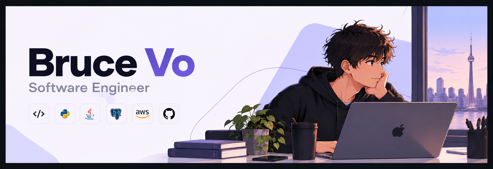

# Hi, I'm Bruce 👋 🧑‍💻

I'm a software engineer in Toronto who builds tools for students and AI systems that show their evidence. I mostly work in Python, Java, and TypeScript, ship things people can actually `pip install`, and play semi-pro pool on the side.

## Find me around the web 🌎

- Building in public on [brucevo.site](https://brucevo.site) 🛠️
- Sharing updates on [LinkedIn](https://www.linkedin.com/in/brucevo/) 💼
- Saying hi at [brucevo158@gmail.com](mailto:brucevo158@gmail.com) ✉️

## Recent Projects

1. [bb-cli](https://github.com/Bruce1508/bb-cli) (Python): Blackboard in your terminal, syncs deadlines and grades and answers questions in plain English. On PyPI.
2. [VisionArcade](https://github.com/Bruce1508/VisionArcade) (Java): turns a live webcam into a real-time arcade controller with local ONNX pose detection.
3. [beyond90](https://github.com/Bruce1508/beyond90) (Java, Next.js): evidence-first 3D football intelligence with Spring Boot, Next.js/R3F, and Microsoft Foundry.
4. [respiralab](https://github.com/Bruce1508/respiralab) (Python): reproducible respiratory sound classifier on ICBHI 2017, live on Streamlit.

## Hackathons

**2025**
DeltaHacks → Hack The 6ix → NewHacks → HackTrent → Anthropic AI Toronto Hackathon

**2026**
SummerHacks → Seneca Hackathon → Hack The North → Hack The Hill

## Fun Facts

- football fan - rarely miss a match
- shoe collector - 20+ pairs and counting
- semi-pro pool player
